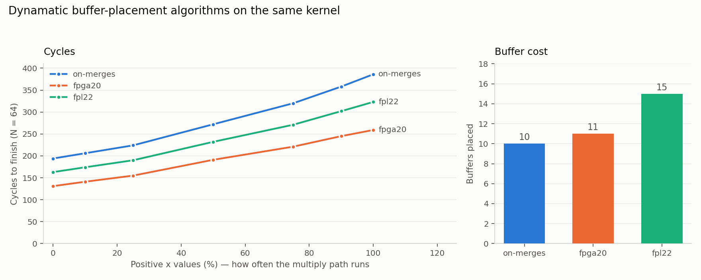

# Trying Dynamatic's buffer placement algorithms

I started reading *Buffer Placement and Sizing for High-Performance Dataflow
Circuits* (FPGA 2020) after the comparison in
[`dynamatic_comparison.md`](dynamatic_comparison.md), because the one place
Dynamatic clearly beat my hand-built circuit was buffer placement. Partway
through I noticed the frontend exposes several algorithms, so I ran the ones my
build supports against the same kernel and the same input mixes.

Same setup as the other writeup: `N = 64`, 4-cycle multiplier, CBC as the MILP
solver, and Dynamatic's default target clock period of 4 ns.

## What ran

| Algorithm | What it optimises | |
|---|---|---|
| `on-merges` | nothing, just enough buffering to be correct | ran |
| `fpga20` | throughput | ran |
| `fpl22` | throughput and timing | ran |
| `costaware` | throughput and area | `Quadratic constraints is currently unavailable for CBC!` |
| `mapbuf` | placement plus technology mapping | crashed inside Dynamatic's CBC path |

Both failures are about the solver, not the kernel. `costaware` needs a
quadratic objective and only Gurobi supports that. `mapbuf` found its AIG
library fine and then aborted on a variable-naming check, which looks like a
bug on the CBC path rather than anything I did.

So this is a comparison of three algorithms, not five.

## Results



| Positive x (%) | `on-merges` | `fpga20` | `fpl22` |
|---:|---:|---:|---:|
| 0   | 194 | 131 | 163 |
| 10  | 206 | 141 | 174 |
| 25  | 224 | 155 | 190 |
| 50  | 272 | 191 | 232 |
| 75  | 320 | 221 | 271 |
| 90  | 358 | 245 | 302 |
| 100 | 386 | 259 | 323 |

| Algorithm | Buffers | Opaque | Transparent | FIFO | Components | II fast | II slow |
|---|---:|---:|---:|---:|---:|---:|---:|
| `on-merges` | 10 | 5 | 5 | 0 | 44 | 3.0 | 6.0 |
| `fpga20` | 11 | 7 | 2 | 2 | 45 | 2.0 | 4.0 |
| `fpl22` | 15 | 9 | 6 | 0 | 49 | 2.5 | 5.0 |

All 21 runs passed Dynamatic's own functional check against the C reference.

As before the IIs are not fitted, `cycles = 64 × II + c` reproduces every
number exactly.

## What I take from this

`fpga20` was fastest at every data point, and it cost one buffer and one
component more than the correctness-only baseline. Against that baseline it is
1.49× faster at 100% positive inputs. That is a much better return than I
expected for essentially no extra area, and it is the clearest argument for
automated buffer placement I came across while doing this.

`on-merges` is the useful control, because it is doing the same job I did by
hand: break the combinational cycles, do not try to be fast. It lands at II = 6
on the multiply path, which is two cycles worse than the 4-cycle multiplier
itself. So a third of every slow iteration there is handshake overhead.

## Why `fpl22` came out slower, as far as I can tell

`fpl22` is the newer algorithm and it lost on cycles, 15 buffers for 323 cycles
against `fpga20`'s 11 for 259. That did not make sense to me, so I re-ran both
with `--calculate-path-delays`, which dumps the MILP variables, and counted
what each one constrains:

| | `fpga20` | `fpl22` |
|---|---|---|
| `dataPath*` variables | 59 | 53 |
| `validPath*` variables | 0 | 53 |
| `readyPath*` variables | 0 | 53 |
| Worst data path it models | 2.718 ns | 4.0 ns, at the target |
| Worst valid path it models | not modelled | 4.0 ns, at the target |
| Worst ready path it models | not modelled | 4.0 ns, at the target |
| Throughput it predicts | 0.25, so II 4 | 0.2, so II 5 |

`fpga20` has no `valid` or `ready` path variables at all. It models the data
path only. `fpl22` models all three and has to spend buffers keeping the
handshake paths under the target period.

If that is right then comparing them on cycles alone is not really fair.
`fpga20` gives a circuit with fewer cycles whose real clock period I do not
know, and `fpl22` gives one with more cycles whose clock period is at least
constrained. Runtime is cycles times clock period and I only measured the first
part. Settling it needs synthesis, which I have not run.

I should be clear that I have not read the FPL 2022 paper. The table above is
what I counted in the dumped MILP, and the explanation is my reading of it, not
something I can cite.

One thing that did reassure me: both algorithms' predicted throughputs, 0.25
and 0.2, match the multiply-path IIs I measured, 4 and 5. So the models are at
least honest about the part they do model.

## Reproducing

```bash
export DYNAMATIC_DIR=~/dynamatic-ws/dynamatic      # your Dynamatic build
python3 scripts/dynamatic_buffer_sweep.py          # 3 algorithms × 7 input mixes
python3 scripts/plot_buffer_algorithms.py
```

Raw numbers in [`../results/buffer_algorithms.csv`](../results/buffer_algorithms.csv).
The dumped MILP solutions behind the path table are in
[`../results/dynamatic/`](../results/dynamatic/) as `milp_delays_*.txt`.
