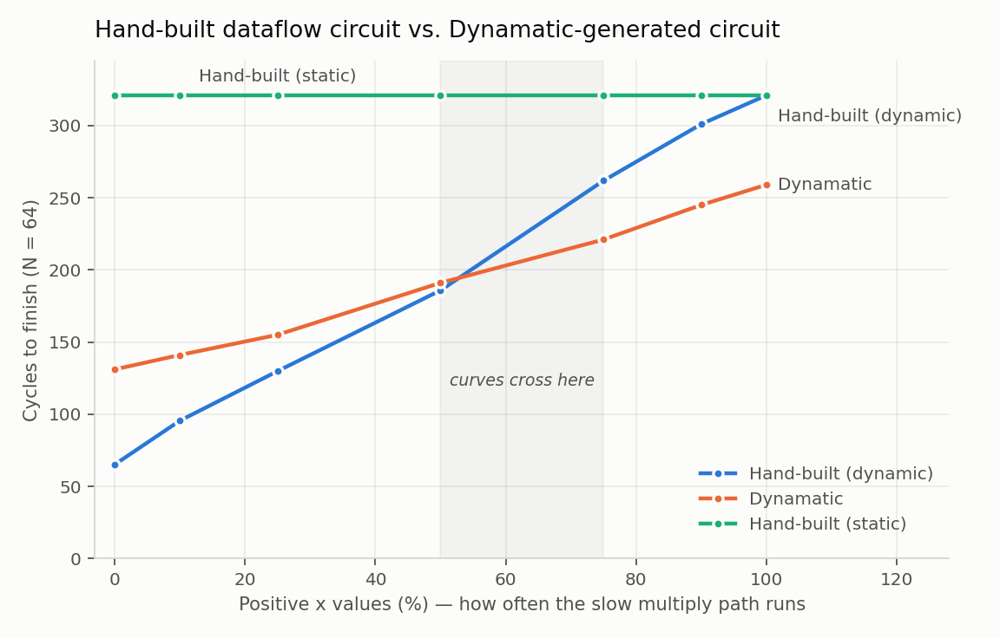

# My circuit vs the one Dynamatic generates

Same C kernel, compiled two ways: by hand into `rtl/kernel_dynamic.vhd`, and by
[Dynamatic](https://github.com/EPFL-LAP/dynamatic) v2.0.0.

```c
int kernel(int x[N]) {
  int s = 1;
  for (int i = 0; i < N; i++) {
    if (x[i] > 0) s = s * x[i];
    else          s = s + x[i];
  }
  return s;
}
```

Both use `N = 64`. Dynamatic's timing database picks latency 4 for a 32-bit
multiply, which happens to be the same as this project's `MUL_LATENCY` default,
so the arithmetic is not what differs between them.

## Setting up the Dynamatic side

Dynamatic has no prebuilt binary and the Dockerfile only installs dependencies,
so it has to be built. The LLVM part can be downloaded instead of compiled,
which makes it much lighter than it first looks:

```bash
sudo apt-get install -y clang lld ccache cmake ninja-build python3 graphviz \
                        git curl gzip libreadline-dev libboost-all-dev
git clone --recurse-submodules https://github.com/EPFL-LAP/dynamatic.git
cd dynamatic && ./build.sh --release --use-prebuilt-llvm --enable-cbc
```

`--enable-cbc` builds the CBC solver, which the buffer placement MILP needs.
Gurobi is the default and is better supported, but it needs a licence.

On Ubuntu 24.04 the HDL generation step fails with `status 32512` because
Dynamatic calls `python` and the distro only ships `python3`. `sudo apt install
python-is-python3` fixes it.

Then, from the Dynamatic directory:

```
dynamatic> set-src integration-test/elasticflow/elasticflow.c
dynamatic> compile --buffer-algorithm fpga20 --milp-solver cbc
dynamatic> write-hdl --hdl vhdl
dynamatic> simulate --simulator ghdl
```

The kernel in Dynamatic's integration-test format is in
[`../results/dynamatic/`](../results/dynamatic/) along with everything it
generated.

## Cycle counts



| Positive x (%) | Hand-built | Dynamatic | Hand-built static |
|---:|---:|---:|---:|
| 0   | 65.0  | 131 | 321 |
| 10  | 95.4  | 141 | 321 |
| 25  | 129.8 | 155 | 321 |
| 50  | 185.8 | 191 | 321 |
| 75  | 261.8 | 221 | 321 |
| 90  | 301.0 | 245 | 321 |
| 100 | 321.0 | 259 | 321 |

The curves cross at somewhere around 55 to 60 percent positive inputs. Neither
circuit is better everywhere.

Per-iteration initiation interval, which is where the whole difference lives:

| Path taken | Hand-built | Dynamatic |
|---|---:|---:|
| `s + x[i]` (fast) | 1 | 2 |
| `s * x[i]` (slow) | 5 | 4 |

These are not fitted. `cycles = 64 × II + c` reproduces every measurement
exactly, with `c = 1` for mine and `c = 3` for Dynamatic's.

### Why mine wins on the fast path

Mostly because of the interface, not the scheduling. I take `x` as a stream
through a handshake port. Dynamatic generates a BRAM and a memory controller,
and the load sits inside the loop, which costs about a cycle per iteration.

The gap is almost exactly one cycle per iteration, which fits that explanation,
but I have not isolated it properly. See
[open question 1](open-questions.md).

### Why Dynamatic wins on the slow path

Its buffer placement gets the `s` recurrence down to II = 4, which is exactly
the multiplier latency, so there is no handshake overhead left on that path at
all. My hand-placed `oehb` + `tehb` pair sits at II = 5.

This one I am fairly confident about, and it is the result I found most useful.
The thing I placed by hand after reading about it is one cycle worse than what
the MILP found automatically, on the only metric buffer placement is really
for.

## Structure

| | Hand-built | Dynamatic |
|---|---|---|
| Component instances | 30 | 45 |
| Input `x` | streamed in through a handshake port | BRAM + `mem_controller` + `load` |
| Branch | `cond_br` → `mul`/`add` → `merge` | if-converted to `select` |
| Loop header | 2 × `merge` | 2 × `mux` + 1 × `control_merge` |
| Buffers | 2 hand-placed `oehb`+`tehb` pairs | 11, placed by a MILP |
| Index arithmetic | 32-bit throughout | narrowed to 6 and 7 bits |

Two things Dynamatic does that I did not think to do: it narrows bitwidths, so
the loop counter becomes 6 or 7 bits instead of 32, and it emits a real memory
subsystem instead of assuming someone will hand it a stream.

Its buffers turned out to be the same two primitives I had built.
`ONE_SLOT_BREAK_DV` is an opaque buffer, which is my `oehb.vhd`, and
`ONE_SLOT_BREAK_R` is a transparent one, which is my `tehb.vhd`. That was a
good moment.

The loop header difference is a real limitation on my side rather than a style
choice. `merge` is only safe here because at most one token is in flight.
Dynamatic uses muxes because they stay correct when several iterations overlap.

## The branch disappears before Dynamatic sees it

LLVM if-converts the `if`/`else`. In `clang.opt.ll` the two blocks are gone and
there is a single `select`:

```llvm
%6 = icmp sgt i32 %5, 0
%7 = mul nsw i32 %.012, %5
%8 = add nsw i32 %.012, %5
%.1 = select i1 %6, i32 %7, i32 %8
```

Both operations are issued every iteration. The generated dataflow graph
confirms it: the whole loop body is one basic block with `muli0` and `addi0`
both feeding `select0`.

I expected this to flatten the cycle count to match the static version. It does
not, and the measurements above vary with the input data, so the circuit is
clearly still behaving dynamically.

The generated select carries `antitoken_depth = 1`, and the comment in
Dynamatic's select generator describes it as firing on the chosen input while
recording that it owes a kill for the token that has not arrived yet. That
would account for what I measured.

I want to be careful here though. That explanation comes from a source comment
and from the fact that the numbers move with the data. I have not traced the
protocol in a waveform and I cannot explain the details of how the kill
propagates. It is the part of this project I understand least.

## What this comparison does not settle

- The memory interface difference above, which I could not remove.
- No synthesis, so no clock period and no area. Cycles are half of runtime.
- The hand-built numbers are means over 5 seeds. Each Dynamatic point is one
  deterministic dataset, recompiled from scratch, because `fpga20` places
  buffers from a profile of the input data.

Every Dynamatic data point was checked against the C reference by its own GHDL
testbench, and all seven reported `C and VHDL outputs match`.

## Reproducing

```bash
export DYNAMATIC_DIR=~/dynamatic-ws/dynamatic   # your Dynamatic build
bash scripts/dynamatic_sweep.sh
python3 scripts/sweep.py --n 64 --mul-latency 4
python3 scripts/plot_dynamatic_comparison.py
```
